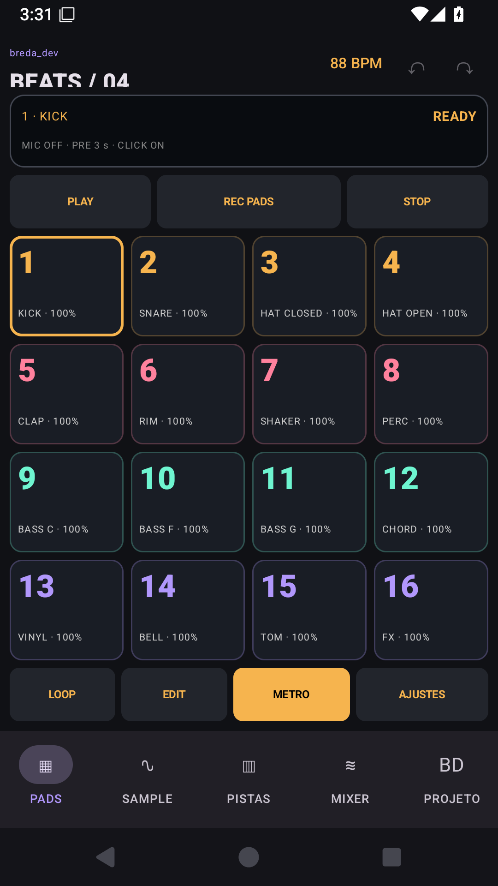
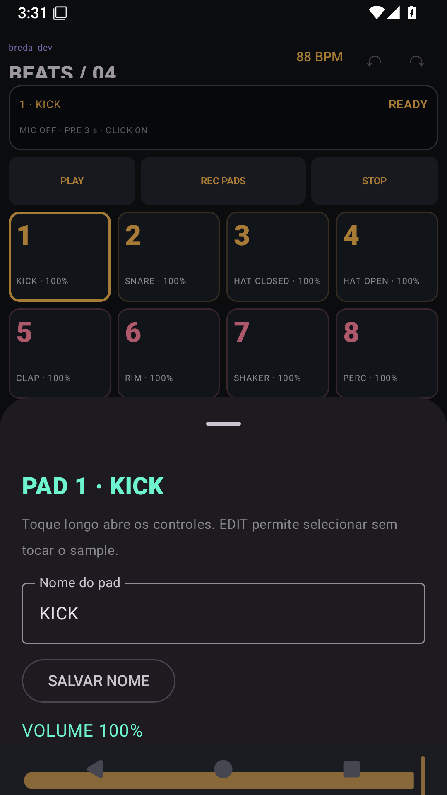
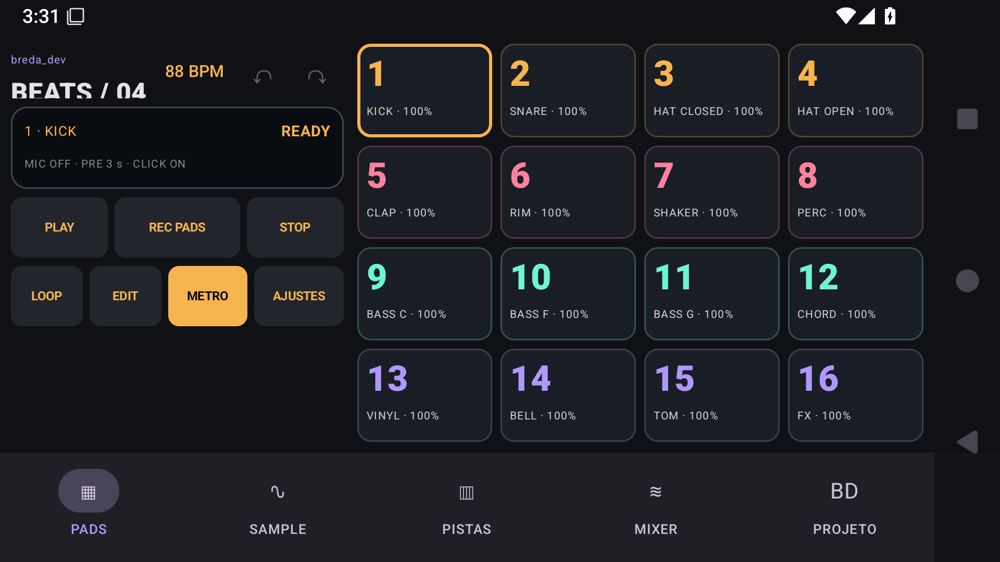

# Fluxos de uso — Breda Beats Studio

Oferecer um fluxo compacto de produção de batidas com marca original e controle explícito de gravação e microfone.

## Mapa de telas

| Tela / área | O que a pessoa faz | Referência de implementação |
|---|---|---|
| Pads | Tocar kit, preparar REC e controlar transporte. | [PerformanceScreen.kt](../androidApp/src/main/kotlin/dev/breda/beats/PerformanceScreen.kt) |
| Editor do pad | Ajustar volume, pan, pitch, loop/gate e grupo de corte. | [ProductionPanels.kt](../androidApp/src/main/kotlin/dev/breda/beats/ProductionPanels.kt) |
| Sample | Editar waveform, recortar e dividir amostra. | [StudioPanels.kt](../androidApp/src/main/kotlin/dev/breda/beats/StudioPanels.kt) |
| Pistas e mixer | Editar notas, arranjar sequências e mixar canais. | [ProductionPanels.kt](../androidApp/src/main/kotlin/dev/breda/beats/ProductionPanels.kt) |
| Projeto | Salvar backup editável e exportar áudio. | [ProjectCodec.kt](../androidApp/src/main/kotlin/dev/breda/beats/data/ProjectCodec.kt) |

## Demonstração guiada

Use dados fictícios, em ambiente de avaliação.

1. Toque o kit com MIC OFF e escolha BPM e preparação de três segundos.
2. Grave notas nos pads depois da contagem; pare e reproduza.
3. Segure o kick e ajuste 70%; mantenha a caixa em 100%.
4. Duplique uma sequência, altere as notas e monte o arranjo.
5. Ajuste o mixer, exporte WAV/stems e salve também um ZIP editável.

## Casos que merecem atenção

- STOP, background ou MIC OFF durante preparação cancelam captura pendente.
- Backup inválido deve preservar o projeto atual.
- Metronômo não entra no render interno; pode vazar pelo alto-falante para o microfone.

## Escopo e resultado esperado

Não é paridade completa com Koala, MPC ou DAW desktop. Sem time-stretch independente, MIDI, plugins, automação ou gravação contínua multifaixa. Pitch muda velocidade/duração; vozes ao vivo limitadas a 32. Render corta caudas nos limites e usa hard clipping; latência física não medida.

## Galeria e contexto

As imagens abaixo representam um instante de uma execução automatizada. Uma captura estática não demonstra som, suavidade de animação, latência ou persistência.

### Pads fixos em retrato

### Editor do pad por toque longo

### Pads fixos em paisagem

## Checklist para validação do proprietário

- [ ] Instalar/abrir a versão correspondente às evidências.
- [ ] Percorrer a jornada principal e uma condição de falha.
- [ ] Confirmar navegação, retorno, teclado e leitura em tela pequena.
- [ ] Fechar/reabrir e verificar os dados que devem persistir.
- [ ] Avaliar os recursos nativos pertinentes no aparelho real.
- [ ] Registrar versão, aparelho, resultado esperado e observado em eventual relato.

[Voltar ao README](../README.md) · [Evidências](evidencias.md)
